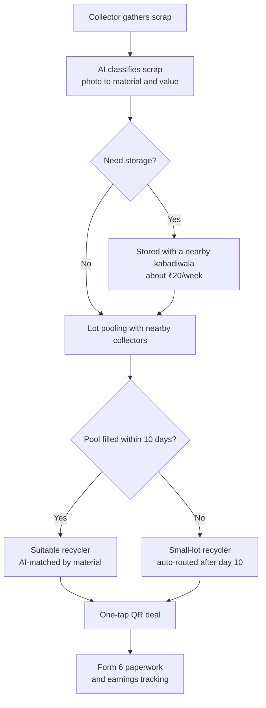

# Kabadiwala Connect

**One app. Two roles. Zero hassle.**

A role-based mobile platform that connects India's informal e-waste collectors (*kabadiwalas*) with authorized recyclers. It uses AI to classify scrap, pools small lots into pickup-ready ones, and handles the paperwork.

> Built by **Team Six of Codes** for Smart India Hackathon 2026
> Problem Statement **SIH26229** · Ministry of Mines · Theme: Clean & Green Technology

---

## Why this exists

Informal collectors handle most of India's e-waste, yet the formal recycling chain treats them as outsiders.

- **Collectors** settle for below-market rates, can't tell authorized recyclers from unauthorized ones, struggle with compliance paperwork, and are turned down because their lots are small and irregular.
- **Recyclers** lack market visibility, face documentation burdens, and won't send a vehicle for small lots because they'd bear the logistics cost.
- **The environment** pays for it through backyard processing: open burning, acid leaching, and the loss of recoverable minerals.

Kabadiwala Connect closes this gap with one connected workflow.

## How it works



## Features

**AI classification and smart routing**
- Photograph a scrap lot; AI identifies the materials and estimates their value
- Routes each lot to a suitable recycler

**Pooling and logistics**
- Pools small lots with nearby collectors headed to the same recycler
- Nearby storage with another kabadiwala (about ₹20/week) until the pool completes
- Lots stuck for over 10 days are rerouted to a recycler that accepts smaller lots
- Network of nearby and distant collectors

**Trust and paperwork**
- Verified, authorized recyclers with their minimum lot sizes and details
- One-tap, hash-encrypted, verified QR record for every transaction
- Form 6 and other government documents auto-filled in official color coding, exported as editable PDFs
- Cash transaction records alongside digital ones

**Market and earnings**
- Live price trends and market news, with speech-to-text support
- Monthly tracking of earnings, lots sold and lots collected

**Easy for everyone**
- Works in low-network areas (offline-first)
- Multilingual interface designed for low digital literacy
- No training needed, and a guided dashboard that moves you to the next step automatically

## Tech stack

| Layer | Technology | Purpose |
|---|---|---|
| Mobile app | Flutter + Dart | Android app for collectors and recyclers |
| Backend and AI | FastAPI + Python | APIs and AI features |
| Database | PostgreSQL + PostGIS | Location-based data and queries |
| Offline storage | SQLite (Drift) | Offline operation and sync |
| On-device AI | YOLO + TFLite | Material identification without a network |
| Auth | Firebase Authentication | Secure user access |
| Maps | Google Maps / MapLibre (OpenStreetMap data) | Recycler and storage-partner discovery |
| File storage | S3 / Cloudflare R2 | Images and documents |
| Notifications | Firebase Cloud Messaging | Alerts and status updates |

## Project structure

```
lib/
├── models/     lot, pool, recycler, form6_manifest, stores
├── screens/    camera capture, detected-items review, create lot,
│               routing result, batch routing summary,
│               Form 6 signing, lot history
├── services/   classifier (manual and API-backed), crypto,
│               location, recycler matching
├── data/       mock data (recyclers, storage points)
├── app_colors.dart
├── app_strings.dart
└── main.dart

ai-service/
└── server.py   inference server wrapping the AI engine
```

## Getting started

### Prerequisites
- Flutter SDK (stable) and an Android device or emulator
- Python 3.10+ for the AI service

### Run the app

```bash
git clone https://github.com/devansh6291/kabadiwala.git
cd kabadiwala
flutter pub get
flutter run
```

### Run the AI service

```bash
cd ai-service
pip install -r requirements.txt   # install the service's dependencies
python server.py
```

Point the app at the running service by setting the base URL in `lib/services/api_classifier_service.dart`.

Set `SEG_CKPT` and `VAL_CKPT` to your trained segregation and valuation checkpoints. Without them, the server returns correctly shaped but untrained output.

### Classification API

`POST /classify` (multipart image upload) returns:

```json
{
  "pipelineRoute": "...",
  "category": "...",
  "subCategory": "...",
  "approxWeightKg": 0.0,
  "weightSource": "...",
  "estimatedValue": 0.0,
  "physicalCondition": "...",
  "detectedMaterials": [],
  "materialProbabilities": { "copper": 0.0, "gold": 0.0 },
  "confidence": { "segregation": 0.0, "category": 0.0, "subCategory": 0.0, "condition": 0.0 }
}
```

## Project status

This is a hackathon prototype under active development.

| Area | Status |
|---|---|
| Lot capture, review, and history screens | Built |
| Routing and pooling logic (direct dispatch, pool, storage routing) | Built, runs on mock recycler data |
| Form 6 signing flow | Built |
| API-backed classifier client | Built |
| Trained AI checkpoints | In progress |
| Live recycler, pricing, and market-news backends | Built |
| QR verification, offline sync, multilingual UI | Built |

## Projected impact

These are estimates for the prototype, not measured results.

- 40–70% higher earnings for kabadiwalas through better pricing and pooled volumes
- 30–50% lower individual transport costs through pooling
- 2–3x increase in formal e-waste collection
- More verified transactions, and wider access to authorized recyclers across districts

## References

- [CPCB: E-Waste Management Rules](https://cpcb.nic.in/)
- [MoEFCC: EPR Guidelines](https://moefcc.gov.in/)
- [OpenStreetMap](https://www.openstreetmap.org/)
- [Ultralytics YOLO](https://github.com/ultralytics/ultralytics)
- [PostGIS](https://postgis.net/)
- Similar platforms for case study: Recircle, Attero, EzyRecycler

<!-- Add a license, e.g. MIT -->
